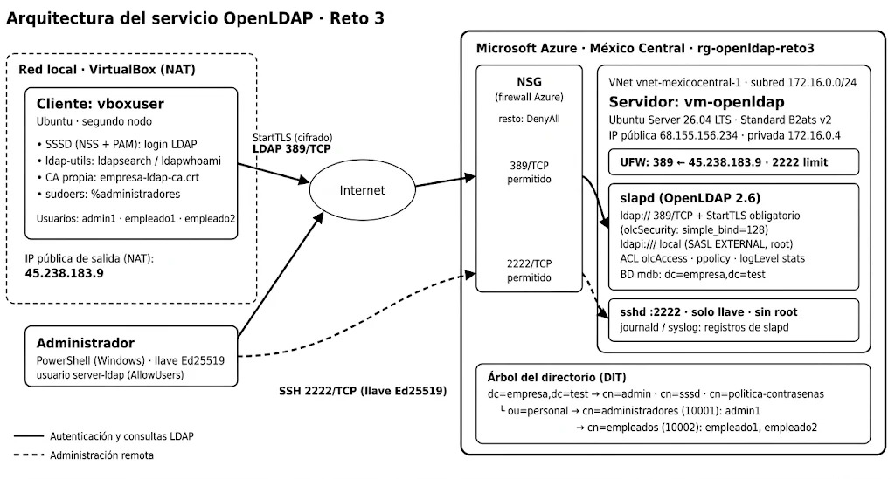

# Reto 3 — Gestión centralizada de usuarios con OpenLDAP


Servicio de directorio **OpenLDAP** en un servidor Ubuntu Server 26.04 LTS en Microsoft Azure. Centraliza la identidad y la autenticación de los usuarios de una empresa ficticia (`dc=empresa,dc=test`). Un cliente Ubuntu en VirtualBox consulta el directorio e inicia sesión con sus usuarios a través de Internet, con cifrado StartTLS obligatorio.

📄 Informe técnico completo: [`docs/Informe_Final_Reto3_OpenLDAP.pdf`](docs/Informe_Final_Reto3_OpenLDAP.pdf)

## Arquitectura



| Elemento | Dirección / puerto | Función |
|---|---|---|
| Servidor `vm-openldap` | 68.155.156.234 (pública) · 172.16.0.4 (privada) | OpenLDAP (`slapd`) |
| Cliente `vboxuser` | VirtualBox con NAT · sale por 45.238.183.9 | Consultas y login LDAP (SSSD) |
| LDAP | 389/TCP con StartTLS obligatorio | Comunicación cifrada entre nodos |
| SSH | 2222/TCP, solo llave Ed25519 | Administración del servidor |

**Directorio:** `dc=empresa,dc=test` → `ou=personal` → grupos `administradores` (10001) y `empleados` (10002) → usuarios `admin1`, `empleado1`, `empleado2`. Además, `cn=sssd` (cuenta de servicio de solo lectura) y `cn=politica-contrasenas`.

## Estructura del repositorio

```
servidor/   Configuración del servidor (cn=config, ACL, ppolicy, TLS, SSH, UFW)
cliente/    Configuración del cliente (ldap.conf, SSSD, sudoers)
docs/       Informe técnico y diagrama de arquitectura
evidencias/ Capturas de las pruebas de validación
```

## Configuración del servidor

Todos los LDIF se aplican como root por `ldapi:///` con SASL EXTERNAL, en este orden:

| Archivo | Qué hace | Comando |
|---|---|---|
| `tls.ldif` | Rutas de la CA, certificado y clave del servidor | `sudo ldapmodify -Y EXTERNAL -H ldapi:/// -f tls.ldif` |
| `seguridad.ldif` | `olcSecurity: simple_bind=128`: rechaza contraseñas sin cifrar | `sudo ldapmodify -Y EXTERNAL -H ldapi:/// -f seguridad.ldif` |
| `logging.ldif` | `olcLogLevel: stats`: registra conexiones y BIND | `sudo ldapmodify -Y EXTERNAL -H ldapi:/// -f logging.ldif` |
| `01-acl.ldif` | ACL: anónimo no lee, usuarios leen, administradores escriben | `sudo ldapmodify -Q -Y EXTERNAL -H ldapi:/// -f 01-acl.ldif` |
| `02-miembros.ldif` | `memberUid` de cada grupo (lo usan las ACL) | `sudo ldapmodify -Q -Y EXTERNAL -H ldapi:/// -f 02-miembros.ldif` |
| `03-cuenta-sssd.ldif` | Cuenta de solo lectura para los clientes | `sudo ldapadd -Q -Y EXTERNAL -H ldapi:/// -f 03-cuenta-sssd.ldif` |
| `04-modulo-ppolicy.ldif` | Carga el módulo de política de contraseñas | `sudo ldapmodify -Q -Y EXTERNAL -H ldapi:/// -f 04-modulo-ppolicy.ldif` |
| `05-politica.ldif` | Mínimo 8 caracteres, historial 3, bloqueo tras 3 fallos | `sudo ldapadd -Q -Y EXTERNAL -H ldapi:/// -f 05-politica.ldif` |
| `06-overlay-ppolicy.ldif` | Activa la política sobre la base de datos | `sudo ldapadd -Q -Y EXTERNAL -H ldapi:/// -f 06-overlay-ppolicy.ldif` |
| `07-desbloquear.ldif` | Desbloquea una cuenta bloqueada | `sudo ldapmodify -Q -Y EXTERNAL -H ldapi:/// -f 07-desbloquear.ldif` |

- `server.ext`: extensiones del certificado del servidor (incluye `subjectAltName=IP:68.155.156.234`).
- `00-hardening.conf`: endurecimiento de SSH (`/etc/ssh/sshd_config.d/`).
- `ufw-reglas.txt`: reglas del firewall.

## Configuración del cliente

```bash
sudo apt install -y sssd-ldap libnss-sss libpam-sss ldap-utils
sudo cp ldap.conf /etc/ldap/ldap.conf
sudo cp sssd.conf /etc/sssd/sssd.conf && sudo chmod 600 /etc/sssd/sssd.conf
sudo pam-auth-update --enable mkhomedir
sudo visudo -f /etc/sudoers.d/ldap-administradores   # contenido: ver ldap-administradores
sudo systemctl restart sssd
```

## Pruebas de validación (desde el cliente)

| Prueba | Resultado esperado | Evidencia |
|---|---|---|
| `ldapwhoami` sin `-ZZ` | `Confidentiality required (13)` | Informe, sección 8.3 |
| `ldapmodify` como admin1 / empleado1 | `modifying entry` / `Insufficient access (50)` | `evidencias/01` |
| ACL aplicadas | 5 reglas `olcAccess` | `evidencias/02` |
| `ldappasswd -s 'abc'` | `Constraint violation (19)` | `evidencias/03` |
| 3 claves incorrectas + la correcta | `Invalid credentials (49)` por bloqueo | `evidencias/04`, `05` |
| `getent passwd` / `id` | Usuarios del directorio en el cliente | `evidencias/06` |
| `su - empleado1` → `sudo whoami` | `sudo` denegado | `evidencias/07` |
| `su - admin1` → `sudo whoami` | `root` | `evidencias/08` |
| SSH en 2222 y UFW | `Port 2222`, `2222/tcp LIMIT` | `evidencias/09`, `10` |
| `apt list --upgradable` | Sin paquetes pendientes | `evidencias/11` |

## Seguridad de este repositorio

No se publican claves privadas (`server.key`, clave de la CA, llave SSH) ni contraseñas. En `03-cuenta-sssd.ldif` y `sssd.conf` las credenciales están reemplazadas por marcadores `<...>`.
